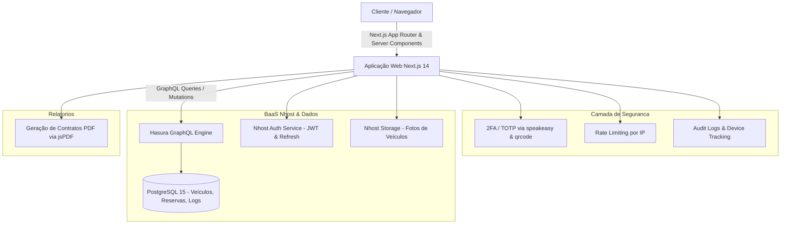

# RentalCar - Sistema de Locação de Veículos

[](https://nextjs.org)
[](https://www.typescriptlang.org)
[](https://nhost.io)
[](LICENSE)

Plataforma full stack para gestão de locação de frotas e reservas de veículos, com catálogo de veículos, cálculo automático de diárias, painel administrativo, rate limiting no login e trilha de auditoria. A autenticação em duas etapas (2FA via TOTP) está em desenvolvimento.

---

## 🏗️ Arquitetura do Sistema



---

## ✨ Funcionalidades Principais

- **Catálogo Dinâmico & Busca Filtrada:** Visualização de veículos com galeria, especificações técnicas, disponibilidade em tempo real e filtros por categoria.
- **Mecanismo de Reservas:** Cálculo automático de diárias com aplicação de taxas, descontos e validação de período de locação.
- **Autenticação em Dois Fatores (2FA/TOTP) — em desenvolvimento:** a tela de segurança já gera o QR Code para o Google Authenticator; falta verificar o código e gravar o segredo no banco.
- **Proteção contra Força Bruta (Rate Limiting):** Bloqueio progressivo de IP após tentativas repetidas de autenticação falha.
- **Trilha de Auditoria (Audit Logs):** Armazenamento estruturado de ações críticas, logins, alterações de status e IP de origem.
- **Geração de Comprovantes em PDF:** Emissão de termos e contratos de locação direto no frontend com `jsPDF`.

---

## 🛠️ Stack Tecnológica & Decisões Técnicas

| Componente | Tecnologia | Decisão Técnica |
| :--- | :--- | :--- |
| **Framework Web** | Next.js 14 (App Router) | Renderização híbrida (SSR/SSG) com Server Components para reduzir o bundle client-side e melhorar SEO. |
| **Linguagem** | TypeScript 5 | Tipagem estática fim a fim com inferência de schemas via Zod e GraphQL Request. |
| **Backend & Dados** | Nhost (PostgreSQL 15 + Hasura) | Redução de tempo de entrega fornecendo backend GraphQL nativo com suporte a subscriptions em tempo real e autorização granular. |
| **Autenticação 2FA** | Speakeasy + QRCode | Geração do segredo TOTP e do QR Code no servidor (ativação em desenvolvimento). |
| **Testes** | Vitest | Execução veloz de testes unitários integrada nativamente ao pipeline de CI. |

---

## 🚀 Como Rodar o Projeto

### Pré-requisitos
- Node.js 18+ e npm
- Projeto ativo no [Nhost](https://nhost.io)

### 1. Clonar o repositório e instalar dependências
```bash
git clone https://github.com/devraphaeldiniz/rentalcar.git
cd rentalcar
npm install
```

### 2. Configurar variáveis de ambiente
Crie um arquivo `.env.local` com suas credenciais:
```env
NEXT_PUBLIC_NHOST_SUBDOMAIN=seu-subdomain
NEXT_PUBLIC_NHOST_REGION=sa-east-1
NHOST_ADMIN_SECRET=seu-admin-secret
```

### 3. Iniciar o servidor de desenvolvimento
```bash
npm run dev
```
Acesse `http://localhost:3000` no navegador.

---

## 🧪 Como Rodar os Testes

Execute os testes automatizados com Vitest:
```bash
npm test
```
Para executar o linter do código:
```bash
npm run lint
```

---

## 📊 Resultados e Métricas

- **Reservas:** validação de reservas (datas e campos obrigatórios) coberta por testes unitários com Vitest (`__tests__/bookings.test.ts`).

---

## ⚠️ Limitações e Próximos Passos

- [ ] Concluir o 2FA: verificar o código TOTP, gravar o segredo e exigir o código no login.
- [ ] Concluir as ações de admin ainda simuladas (bloquear usuário e alterar papel) e a listagem de sessões ativas.
- [ ] Medir a latência p95 das consultas GraphQL de listagem com filtros.
- [ ] Fazer testes de carga com reservas concorrentes no mesmo veículo.
- [ ] Integrar gateway de pagamento para captura e autorização direta de cartão de crédito.
- [ ] Adicionar suporte a devolução com checklist fotográfico enviado pelo cliente.
- [ ] Implementar notificações push via WebSockets / GraphQL Subscriptions no painel admin.

---

## 📄 Licença

Distribuído sob a licença MIT. Consulte [LICENSE](LICENSE) para mais detalhes.
