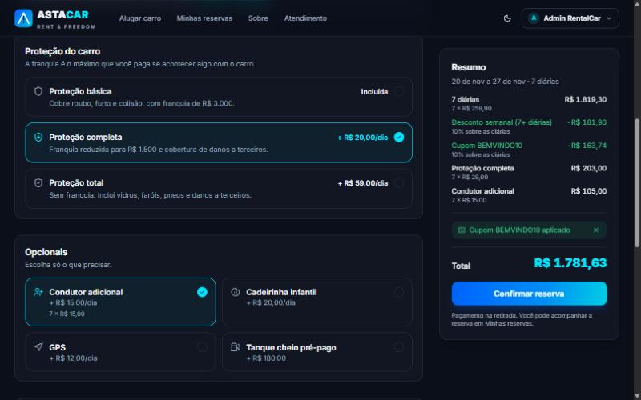
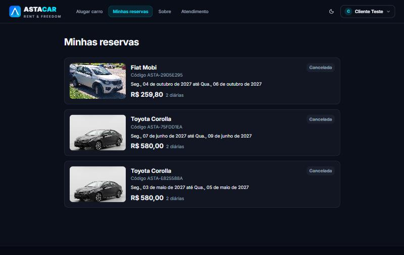
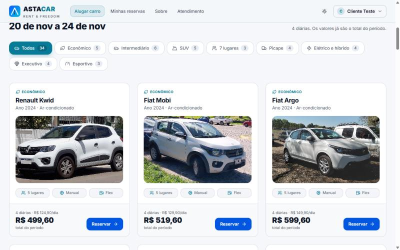
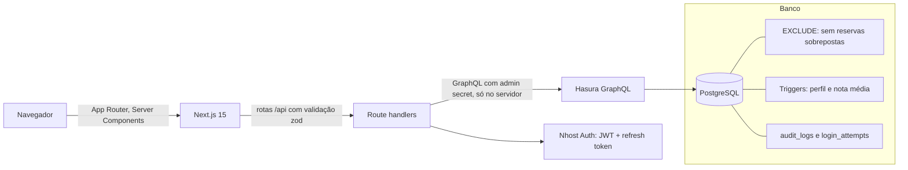

# AstaCar · Aluguel de carros

[](https://github.com/devraphaeldiniz/rentalcar/actions/workflows/ci.yml)
[](https://nextjs.org)
[](https://www.typescriptlang.org)
[](https://nhost.io)
[](LICENSE)

Plataforma full stack de locação de veículos: o cliente escolhe as datas, vê o **valor total do período** de cada carro, reserva, cancela e avalia; o administrador gerencia frota, reservas, usuários e mensagens em um painel próprio.

> Projeto de portfólio. As reservas são de demonstração e não geram cobrança.


---

## Telas

| Catálogo com valor total do período | Detalhe do carro |
| :---: | :---: |
|  |  |
| **Revisão e confirmação da reserva** | **Minhas reservas** |
|  |  |
| **Celular** | **Tema claro** |
|  |  |

---

## ✨ Funcionalidades

**Cliente**
- Catálogo de 32 carros em 8 categorias, com filtro por categoria e fotos creditadas (Wikimedia Commons, Creative Commons).
- Busca por período: cada carro mostra o total do aluguel e os já reservados nas datas aparecem marcados.
- Reserva com revisão final; o preço é sempre recalculado no servidor.
- Minhas reservas: acompanhar status, cancelar e avaliar o carro depois da devolução.
- Meus dados: nome, celular e CPF (com validação dos dígitos) e troca de senha.
- Tema escuro (padrão) e claro, layout responsivo.

**Administrador**
- Dashboard, frota (cadastro e edição), reservas, usuários (papel e bloqueio), avaliações e mensagens do formulário de contato.
- **Funil e visitas:** visitas por dia, funil (visitou → abriu um carro → começou a reserva → reservou), carros mais vistos e motivos de desistência informados no checkout, com monitoramento próprio e consentimento de cookies (LGPD).
- Relatórios com exportação em CSV e PDF.
- Trilha de auditoria das ações sensíveis.

---

## 🏗️ Arquitetura



O navegador nunca fala direto com o Hasura para escrever: toda reserva, cancelamento ou alteração passa por uma rota do Next.js que valida o usuário e os dados antes de gravar.

---

## 🔒 Segurança

- Sessão em cookies `httpOnly` com rotação do refresh token e revogação no logout.
- Limite de tentativas de login por e-mail e por IP (cabeçalhos de proxy só são confiados atrás da Vercel ou com `TRUST_PROXY_HEADERS`).
- Painel admin protegido no servidor (layout com checagem de papel), não só no cliente.
- Cabeçalhos CSP, HSTS, `X-Frame-Options`, `Referrer-Policy` e `Permissions-Policy`.
- Redirecionamentos só para caminhos internos; exportação CSV protegida contra injeção de fórmulas.
- Integridade no banco: restrição `EXCLUDE USING gist` impede duas reservas do mesmo carro no mesmo período, mesmo com pedidos simultâneos.
- `npm audit` sem vulnerabilidades, verificado no CI.

---

## 🛠️ Stack

| Camada | Tecnologia |
| :--- | :--- |
| Framework | Next.js 15 (App Router) + React 18 + TypeScript 5 |
| Interface | Tailwind CSS 3, componentes Radix/shadcn, ícones Lucide, fonte Inter |
| Backend | Nhost: PostgreSQL + Hasura GraphQL + Nhost Auth |
| Validação | Zod |
| Qualidade | Vitest (testes), Biome (lint), TypeScript estrito, GitHub Actions |

---

## 🚀 Como rodar

**Pré-requisitos:** Node.js 22 (fixado em `.nvmrc`) e um projeto no [Nhost](https://app.nhost.io).

```bash
git clone https://github.com/devraphaeldiniz/rentalcar.git
cd rentalcar
npm ci
```

1. Copie `.env.example` para `.env.local` e preencha subdomínio, região e o admin secret do Hasura.
2. Crie o banco inteiro (tabelas, gatilhos, relações, permissões e o catálogo de carros):
   ```bash
   npm run db:setup
   ```
   O comando pode rodar de novo sem duplicar nada: as migrações aplicadas ficam em `schema_migrations`.
3. Crie uma conta pelo site e promova-a a administrador:
   ```bash
   npm run db:setup -- --admin seu@email.com
   ```
4. Inicie o servidor e acesse `http://localhost:3000`:
   ```bash
   npm run dev
   ```

### Scripts

| Comando | O que faz |
| :--- | :--- |
| `npm run dev` | Servidor de desenvolvimento |
| `npm run build` | Build de produção |
| `npm test` | Testes (Vitest) |
| `npm run lint` | Lint (Biome) |
| `npm run typecheck` | Checagem de tipos |
| `npm run db:setup` | Aplica migrações e permissões no Nhost |
| `npm run user:create -- --email ... --name ... [--admin]` | Cria uma conta de teste |

---

## 🧭 Próximos passos

- [ ] Lojas e horários de retirada/devolução, com devolução em outro local.
- [ ] Proteções e opcionais com preço calculado no servidor.
- [ ] Cupons de desconto e programa de pontos.
- [ ] Orçamento para empresas e vitrine de seminovos.
- [ ] Pagamento online (cartão e PIX) via gateway e e-mail de confirmação da reserva.

---

## 📄 Licença

Distribuído sob a licença MIT. Veja [LICENSE](LICENSE).

As fotos dos veículos pertencem aos seus autores e são usadas sob licenças Creative Commons; os créditos estão na página `/creditos` do site.
