<div align="center">


# AstaCar · Aluguel de carros

**Reserva online com o valor total do período antes de confirmar, pagamento pelo Mercado Pago, CNH conferida, contrato em PDF, vistoria na retirada e na devolução e um painel administrativo com agenda, funil de conversão e monitoramento.**

[](https://github.com/devraphaeldiniz/rentalcar/actions/workflows/ci.yml)
[](https://github.com/devraphaeldiniz/rentalcar/actions/workflows/e2e.yml)
[](https://nextjs.org)
[](https://www.typescriptlang.org)
[](https://nhost.io)
[](https://rentalcar-eight.vercel.app)
[](LICENSE)

### [🚗 Ver o site no ar →](https://rentalcar-eight.vercel.app)

<sub>Projeto de portfólio. As reservas são de demonstração e não geram cobrança.<br />Quer só conhecer? Na tela de login, sem cadastro: <b>Entrar como cliente de demonstração</b> (reserve, use cupons, cancele) ou <b>Ver o painel do admin</b> (só leitura, com os dados pessoais mascarados).</sub>

<br />


</div>

---

## Sumário

- [O que a AstaCar faz](#-o-que-a-astacar-faz)
- [Telas](#-telas)
- [Como funciona](#-como-funciona)
  - [Fluxo de uma reserva](#fluxo-de-uma-reserva)
  - [Como o preço é calculado](#como-o-preço-é-calculado)
  - [Pagamento online](#pagamento-online)
  - [CNH, contrato e vistoria](#cnh-contrato-e-vistoria)
  - [Monitoramento e funil](#monitoramento-e-funil)
  - [Contas de demonstração](#contas-de-demonstração)
- [Arquitetura](#-arquitetura)
- [Banco de dados](#-banco-de-dados)
- [API](#-api)
- [Segurança](#-segurança)
- [Stack e decisões técnicas](#-stack-e-decisões-técnicas)
- [Rodando localmente](#-rodando-localmente)
- [Testes e qualidade](#-testes-e-qualidade)
- [Deploy](#-deploy)
- [Próximos passos](#-próximos-passos)

---

## ✨ O que a AstaCar faz

| Para o cliente | Para a locadora (painel admin) |
| :-- | :-- |
| Busca por datas com o **valor total do período** em cada carro | **Agenda** de retiradas e devoluções, atrasos e reservas a confirmar |
| Catálogo de **32 carros em 8 categorias**, com fotos creditadas | **Funil de conversão**: visitas → carro aberto → início da reserva → reserva |
| **Proteções** (básica, completa, total) e **opcionais** (condutor, cadeirinha, GPS, tanque cheio) | **Motivos de desistência** informados pelos clientes (preço, concorrência, datas…) |
| **Desconto automático** por duração e **preço de temporada** | **Preços e opcionais**, **descontos**, **temporadas** e **cupons** editáveis |
| **Cupons de desconto** com validade e limite de usos | **Banners** de ofertas próprias nos espaços do site |
| Aceite dos **termos da locação** e detalhamento do valor | Frota, reservas, usuários (papel e bloqueio), avaliações e mensagens |
| **Pagamento online** (Pix, cartão e boleto) pelo Mercado Pago, ou na retirada | **Vistoria** na retirada e na devolução: km, combustível, avarias e cobranças extras |
| **CNH conferida** antes da reserva (validade na retirada e 2 anos de habilitação) | **Bloqueio de carro** por período para manutenção, revisão ou higienização |
| **Contrato em PDF** e e-mails de confirmação e de lembrete na véspera | **Erros e saúde**: erros do servidor e do navegador agrupados, e `/api/health` |
| Minhas reservas: acompanhar, **cancelar** (com estorno) e **avaliar** | Relatórios com exportação **CSV e PDF** e trilha de **auditoria** |
| Atendimento pelo **WhatsApp** com a mensagem já escrita | **Configurações**: integrações ligadas no ambiente e regras em vigor |
| Tema **escuro e claro**, layout para celular, aviso de cookies (LGPD) | Estatísticas, segurança (tentativas de login) e **painel de demonstração** só leitura |

---

## 📸 Telas

### Cliente

| Catálogo com o total do período | Página do carro com ofertas |
| :---: | :---: |
|  |  |
| **Checkout: proteção, opcionais, cupom e resumo** | **Minhas reservas** |
|  |  |
| **Página por categoria (SEO)** | **Tema claro** |
| 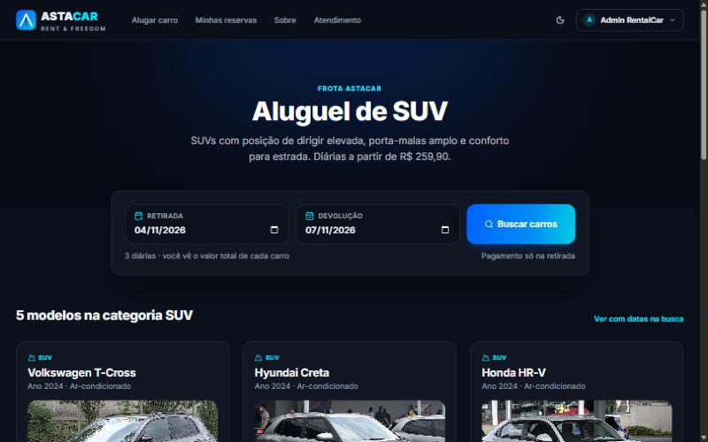 |  |

<p align="center"><br /><sub>Versão para celular</sub></p>

### Painel administrativo

| Funil de conversão e motivos de desistência | Carros mais vistos, aparelhos e origem |
| :---: | :---: |
| 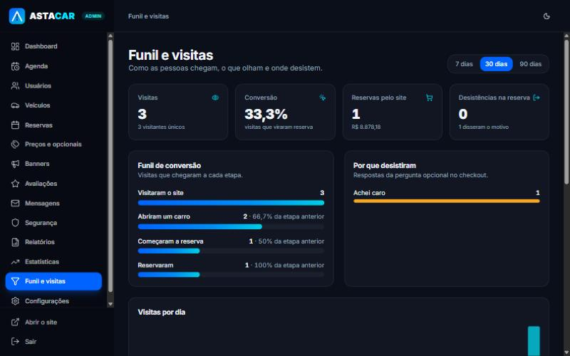 | 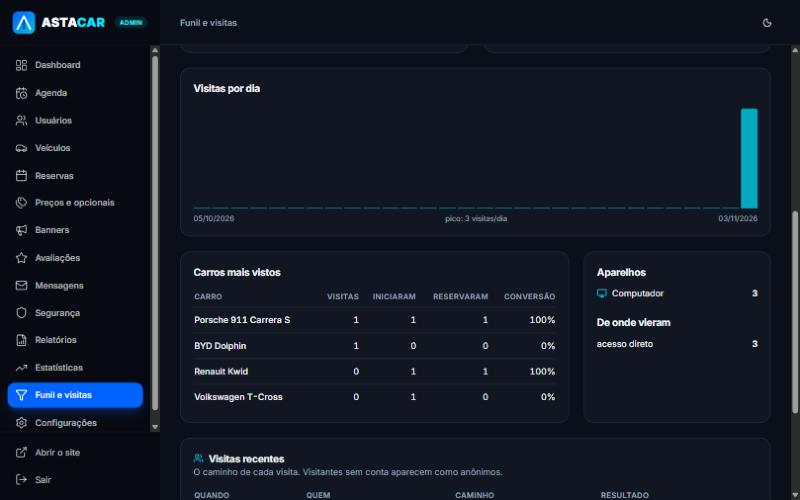 |
| **Agenda de retiradas e devoluções** | **Preço inteligente e cupons** |
| 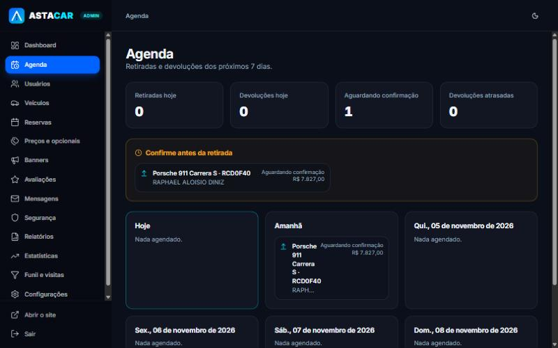 | 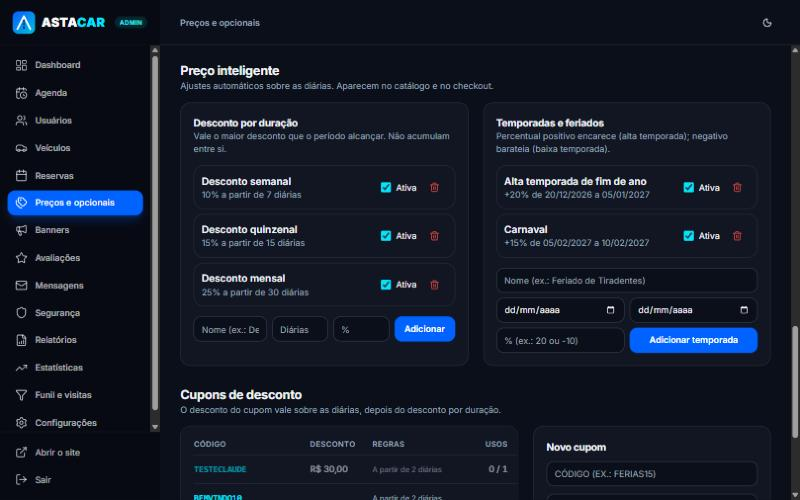 |
| **Vistoria na devolução (painel em modo demonstração)** | **Login com as contas de demonstração** |
| 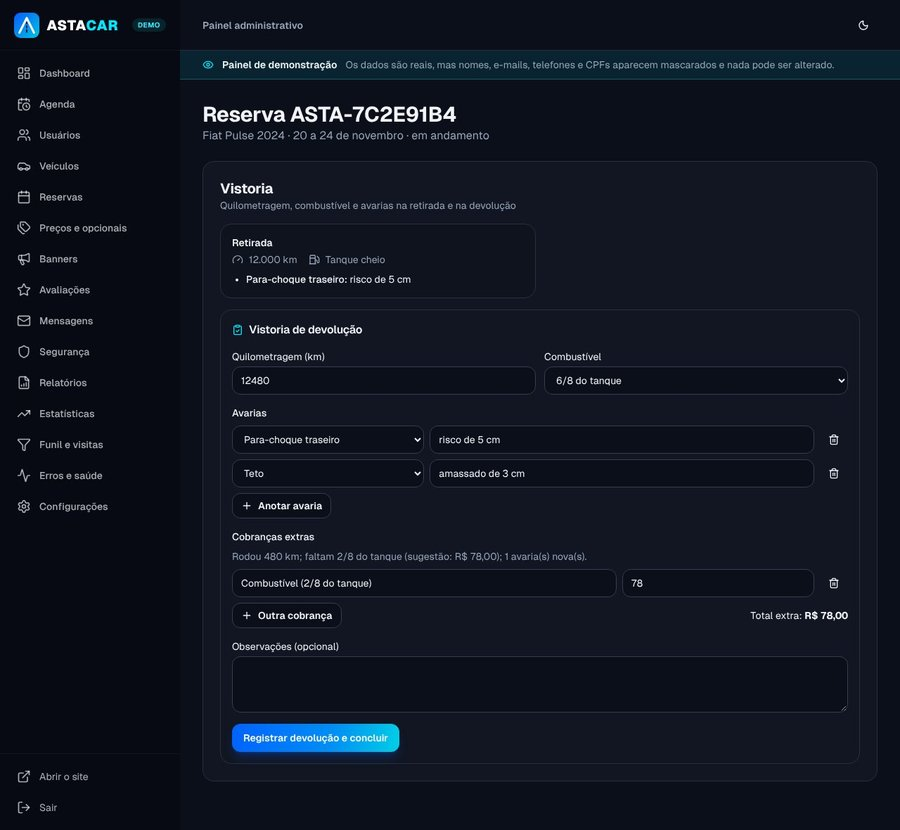 | 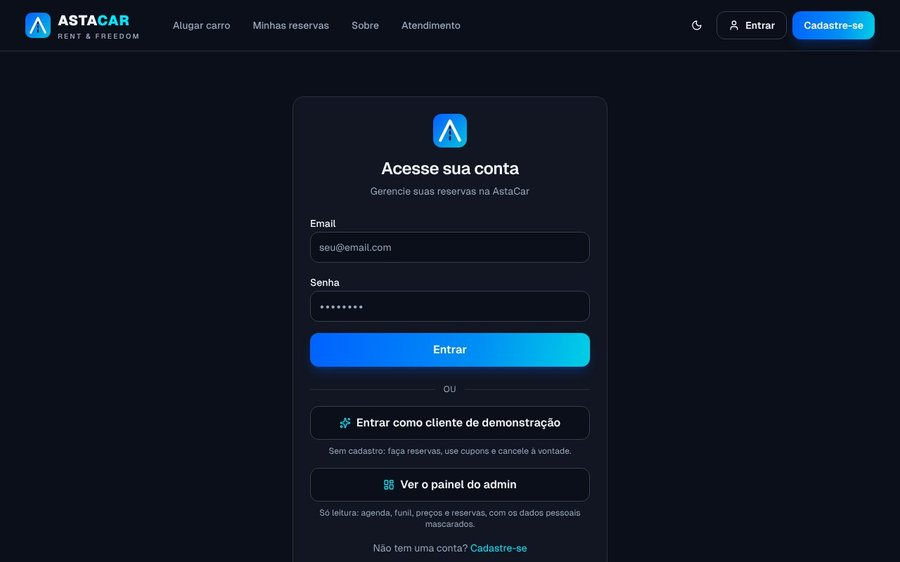 |

<p align="center">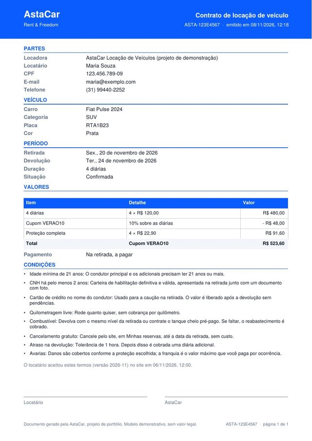<br /><sub>Contrato de locação em PDF gerado no servidor (exemplo com dados fictícios)</sub></p>

---

## ⚙️ Como funciona

### Fluxo de uma reserva

O navegador nunca grava nada direto no banco. Toda escrita passa por uma rota do Next.js que confere quem é o usuário no Nhost Auth, valida os dados e **recalcula o preço** antes de gravar.

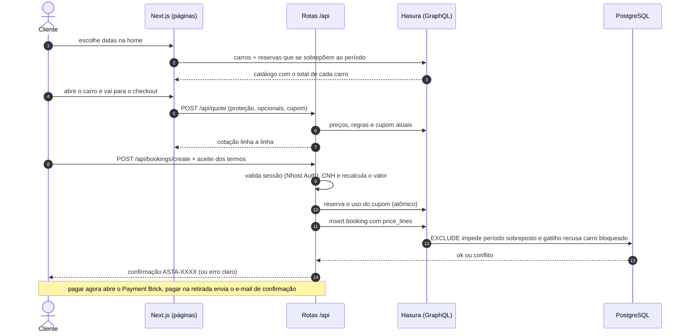

### Como o preço é calculado

Uma única função ([`lib/pricing.ts`](lib/pricing.ts)) é usada no navegador (para mostrar) e no servidor (que decide o valor gravado). A ordem é sempre a mesma:

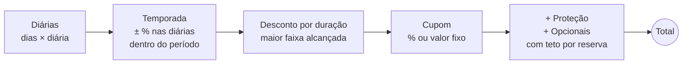

**Exemplo real** (Renault Kwid, 7 diárias, proteção completa, cadeirinha e cupom `BEMVINDO10`):

| Linha | Valor |
| :-- | --: |
| 7 diárias × R$ 124,90 | R$ 874,30 |
| Desconto semanal (7+ diárias) −10% | −R$ 87,43 |
| Cupom BEMVINDO10 −10% | −R$ 78,69 |
| Proteção completa 7 × R$ 29,00 | R$ 203,00 |
| Cadeirinha infantil 7 × R$ 20,00 | R$ 140,00 |
| **Total** | **R$ 1.051,18** |

A reserva guarda esse detalhamento (`price_lines`): se o admin mudar um preço depois, as reservas antigas continuam com o valor que o cliente aceitou.

### Pagamento online

O cliente escolhe no checkout entre **pagar agora** (Pix, cartão ou boleto, pelo Payment Brick do Mercado Pago) e **pagar na retirada**.

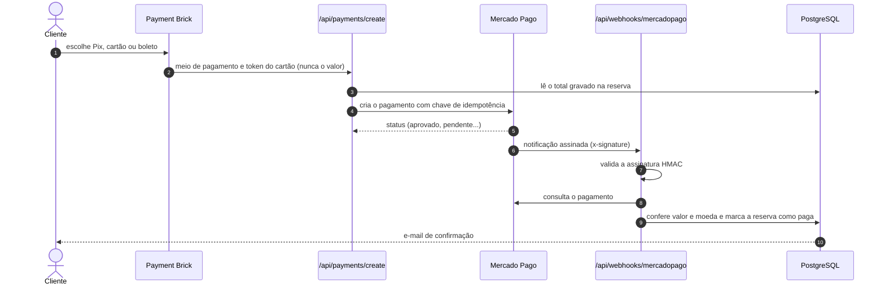

- O **valor cobrado sempre vem da reserva no banco**; do navegador só entram o meio de pagamento e o token do cartão.
- Cada tentativa tem **chave de idempotência** (repetir não cobra duas vezes) e há limite de tentativas por reserva.
- Cancelar uma reserva paga **estorna** o valor integral pelo Mercado Pago antes de cancelar.
- A sincronização é **idempotente**: o mesmo pagamento pode chegar pela criação e por vários webhooks.
- O lembrete da véspera sai pelo **Vercel Cron** (todo dia às 18h de Brasília) e colunas no banco impedem e-mail duplicado.

### CNH, contrato e vistoria

- **CNH:** número com dígitos verificadores, categoria B ou superior, validade na data da retirada e pelo menos 2 anos de habilitação, conferidos no servidor ao criar a reserva. O número completo nunca volta para o navegador.
- **Contrato em PDF:** gerado no servidor (jsPDF) com as linhas de preço gravadas na reserva, as condições da locação e a data do aceite dos termos. Só o dono da reserva ou um admin baixam.
- **Vistoria:** na retirada (confirmada → em andamento) e na devolução (em andamento → concluída). A devolução já vem com as avarias da retirada, mostra os km rodados e as avarias novas e sugere a cobrança do combustível que faltou. O banco recusa devolução sem retirada ou com km menor.
- **Bloqueio de manutenção:** o admin bloqueia um carro por período na Agenda. Ele some da busca, e gatilhos no banco impedem reserva em período bloqueado e bloqueio em cima de reserva ativa.

### Monitoramento e funil

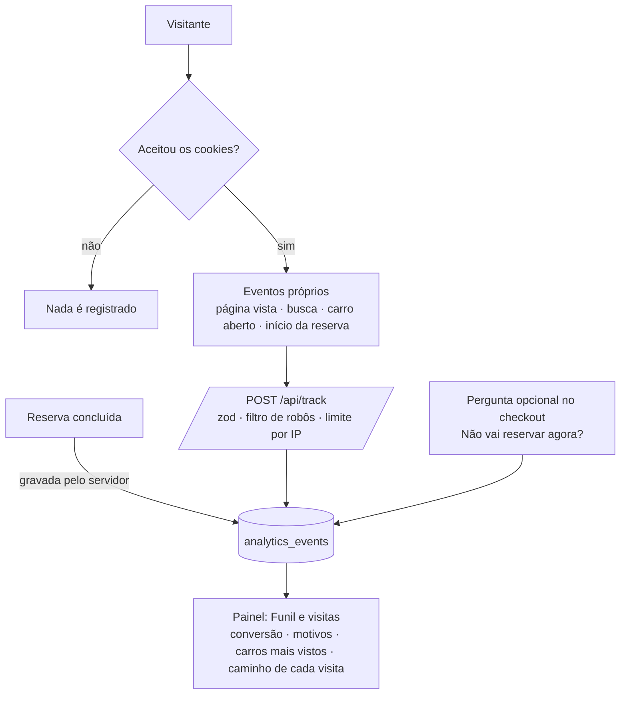

Sem ferramentas de terceiros: não há Google Analytics, e o IP não é guardado. A página [`/privacidade`](https://rentalcar-eight.vercel.app/privacidade) explica o que é coletado.

**Erros e saúde:** erros não tratados do servidor chegam pelo `instrumentation.ts` (`onRequestError` do Next 15) e os do navegador por `/api/monitoring/client-error`. Tudo é gravado sem e-mail, CPF, tokens e query string, agrupado por impressão digital e com limite para um erro em loop não encher o banco. A tela **Erros e saúde** do painel mostra os grupos, e `/api/health` responde 200 ou 503 para monitores externos.

### Contas de demonstração

Para quem avalia o projeto, o login tem dois botões, sem cadastro:

- **Cliente de demonstração:** faz reservas de verdade, com limites para não segurar a frota (até 2 reservas abertas, 7 diárias e retirada em até 60 dias) e sem pagamento online.
- **Painel do admin:** a conta tem papel `client` no banco, então toda rota que altera algo continua recusando **por construção**. Uma checagem só de leitura (`requireAdminView`) libera o painel, e as respostas passam por uma função que mascara nomes, e-mails, telefones, CPFs e IPs.

As credenciais ficam só no servidor; o navegador nunca recebe a senha.

---

## 🏗️ Arquitetura

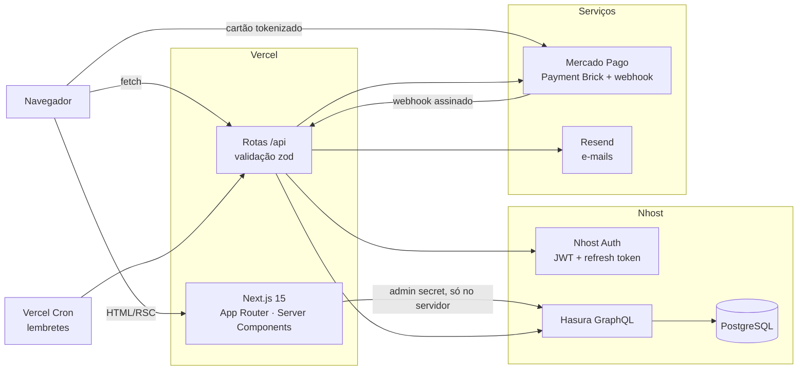

```
app/
  (páginas)            home, carro, checkout, confirmação, minhas reservas, perfil,
                       /aluguel/[categoria], termos, privacidade, sobre, contato
  admin/               painel: agenda, funil, preços, banners, reservas, frota, vistoria, erros...
  api/                 rotas de servidor (auth, reservas, cotação, pagamento, webhooks, cron, admin)
  opengraph-image.tsx  imagem de compartilhamento gerada
  sitemap.ts · robots.ts
components/            interface (cliente, admin, marca, layout, ui)
lib/
  pricing.ts           cálculo do valor (puro, testado)
  pricing-rules.ts     temporada, desconto por duração e cupons
  quote-server.ts      cotação oficial com dados do banco
  analytics/           eventos, coleta e resumo do funil
  auth/ security/      sessão, autorização (inclusive a leitura da demonstração), rate limit, auditoria
  payments/ email/     Mercado Pago e e-mails da reserva
  monitoring/          registro e agrupamento de erros
  cnh.ts inspections.ts vehicle-blocks.ts contract.ts demo-admin.ts
instrumentation.ts     erros do servidor (onRequestError)
nhost/migrations/      001 → 016, aplicadas em ordem pelo db:setup
scripts/               setup do Nhost e criação de contas de teste
__tests__/             Vitest (unidade)
e2e/                   Playwright (ponta a ponta)
```

---

## 🗄️ Banco de dados

PostgreSQL no Nhost, versionado em [`nhost/migrations`](nhost/migrations). O comando `npm run db:setup` aplica cada migração uma única vez (registradas em `schema_migrations`) e configura tabelas, relações e permissões no Hasura.

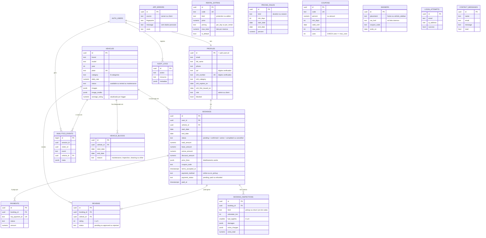

**Regras garantidas pelo próprio banco** (não dependem do código):

| Regra | Como |
| :-- | :-- |
| Um carro não tem duas reservas no mesmo período | `EXCLUDE USING gist` em `bookings` (vale até com cliques simultâneos) |
| Cupom não passa do limite de usos | `CHECK (uses <= max_uses)` + incremento atômico |
| Banner não leva para site externo | `CHECK` com expressão regular em `cta_href` |
| Desconto por duração entre 0 e 60%, temporada com datas válidas | `CHECK pricing_rules_shape` |
| Eventos do funil só de tipos conhecidos | `CHECK` em `analytics_events.event` |
| Perfil criado junto com a conta e nota média do carro sempre atualizada | triggers em `auth.users` e `reviews` |
| Carro bloqueado não recebe reserva, e bloqueio não cai em cima de reserva ativa | `EXCLUDE` em `vehicle_blocks` + gatilhos nas duas tabelas |
| Devolução só depois da retirada e com km maior ou igual | gatilho em `booking_inspections` + `UNIQUE (booking_id, kind)` |
| A mesma CNH não está em duas contas | índice único parcial em `profiles.cnh_number` |
| O mesmo pagamento do Mercado Pago não é gravado duas vezes | `UNIQUE (mp_payment_id)` com upsert |

| Migração | Conteúdo |
| :-- | :-- |
| `001_initial` | perfis, veículos e reservas |
| `002_booking_integrity` | trava contra sobreposição e checagens de valor |
| `003_schema_completo` | avaliações, auditoria, tentativas de login, triggers |
| `004_categorias_e_creditos` · `005_catalogo_frota` | 8 categorias e a frota de 32 carros com créditos das fotos |
| `006_mensagens_contato` | formulário de contato |
| `007_monitoramento` | eventos do funil |
| `008_protecoes_e_termos` | proteções, opcionais e detalhamento do valor |
| `009_precos_e_cupons` | regras de preço e cupons |
| `010_banners` | banners de ofertas |
| `011_pagamentos` | pagamento online e histórico de pagamentos do Mercado Pago |
| `012_emails_reserva` | marcas de envio que impedem e-mail duplicado |
| `013_monitoramento_erros` | erros do servidor e do navegador |
| `014_bloqueios_frota` | bloqueio de carro por período e gatilhos contra conflito com reservas |
| `015_vistorias` | vistoria de retirada e devolução |
| `016_cnh` | dados da CNH no perfil |

As tabelas novas se declaram na própria migração com uma linha `-- @track nome_da_tabela`, e o `db:setup` as registra no Hasura.

---

## 🔌 API

Todas as rotas validam a entrada com **zod**. As do admin exigem papel `admin` conferido no servidor.

<details>
<summary><b>Rotas públicas e do cliente</b></summary>

| Método | Rota | Para quê |
| :-- | :-- | :-- |
| POST | `/api/auth/signup` · `/signin` · `/signout` | cadastro, login (com limite de tentativas) e logout |
| GET | `/api/auth/check` | quem está logado (`?soft=1` responde 200 para visitante) |
| POST | `/api/auth/demo` | entra na conta de demonstração do cliente ou do painel (só leitura) |
| GET | `/api/vehicles/[id]` · `/api/extras` | carro e proteções/opcionais ativos |
| POST | `/api/quote` | cotação oficial (temporada, duração, cupom, opcionais) |
| POST | `/api/bookings/create` | cria a reserva (recalcula o valor e exige o aceite dos termos) |
| GET | `/api/bookings/my` | reservas do cliente |
| POST | `/api/bookings/[id]/cancel` | cancela antes da retirada (devolve o uso do cupom) |
| GET | `/api/bookings/[id]/contract` | contrato da reserva em PDF |
| GET · PATCH | `/api/profile` | dados do cliente (CPF validado) |
| POST | `/api/profile/password` | troca de senha |
| GET · PUT | `/api/profile/cnh` | CNH do cliente e se ela vale para a data da retirada |
| GET · POST | `/api/reviews` | avaliações |
| POST | `/api/contact` | formulário de contato (campo-isca e limite por IP) |
| POST | `/api/track` | eventos do funil (só com consentimento) |
| POST | `/api/monitoring/client-error` | erros do navegador para a tela Erros e saúde |
| GET | `/api/health` | saúde da aplicação para monitores externos (200/503) |
| POST | `/api/webhooks/n8n` | integração opcional, desligada sem segredo forte |

</details>

<details>
<summary><b>Rotas do painel admin</b></summary>

| Rota | Métodos |
| :-- | :-- |
| `/api/admin/dashboard` · `/analytics` · `/security` | GET |
| `/api/admin/bookings` · `/bookings/[id]` | GET · PATCH |
| `/api/admin/bookings/[id]/inspection` | GET · POST (vistoria de retirada e devolução) |
| `/api/admin/blocks` | GET · POST · DELETE (bloqueio de carro por período) |
| `/api/admin/vehicles` · `/vehicles/[id]` | GET · POST · PATCH · DELETE |
| `/api/admin/profiles` · `/profiles/[id]` · `/users/role` · `/users/block` | GET · PATCH · POST |
| `/api/admin/extras` | GET · PATCH |
| `/api/admin/pricing-rules` | GET · POST · PATCH · DELETE |
| `/api/admin/coupons` | GET · POST · PATCH |
| `/api/admin/banners` | GET · POST · PATCH · DELETE |
| `/api/admin/reviews` · `/messages` | GET · PATCH |
| `/api/admin/reports/bookings` · `/reports/financial` | GET |

</details>

---

## 🔒 Segurança

- **Sessão** em cookies `httpOnly` e `secure`, com rotação do refresh token e revogação no logout. O token nunca fica acessível ao JavaScript.
- **Identidade** sempre conferida no Nhost Auth, nunca a partir de um JWT decodificado à mão.
- **Autorização** no servidor: o layout do admin e cada página/rota do painel conferem o papel.
- **Rate limit** no login (por e-mail + IP, e-mail e IP), no cadastro, no contato e no tracking.
- **Preço** sempre recalculado no servidor; o navegador não decide o valor, nem na criação da reserva nem no pagamento.
- **Pagamento**: webhook com assinatura HMAC validada, chave de idempotência, limite de tentativas e valor e moeda conferidos antes de marcar como pago.
- **Painel de demonstração** só leitura por construção (papel `client` no banco) e com dados pessoais mascarados.
- **Monitoramento** sem dados pessoais: e-mails, CPFs, tokens e query strings são removidos antes de gravar.
- **Cabeçalhos**: CSP, HSTS, `X-Frame-Options: DENY`, `Referrer-Policy`, `Permissions-Policy`.
- **Entradas**: redirecionamentos só para caminhos internos, CSV protegido contra injeção de fórmulas, CPF com dígitos verificados.
- **LGPD**: consentimento de cookies, sem IP no monitoramento, página de privacidade.
- **Dependências**: `npm audit` sem vulnerabilidades, verificado no CI.

---

## 🛠️ Stack e decisões técnicas

| Camada | Tecnologia | Por quê |
| :-- | :-- | :-- |
| Framework | **Next.js 15** (App Router) + React 18 | Server Components buscam o catálogo no servidor; rotas `/api` concentram regras e segredos |
| Linguagem | **TypeScript 5** | tipos de ponta a ponta, do banco à interface |
| Dados e auth | **Nhost**: PostgreSQL + Hasura + Auth | banco relacional de verdade com GraphQL pronto e autenticação gerenciada |
| Interface | **Tailwind CSS 3**, Radix/shadcn, Lucide, Inter | tokens de tema (escuro/claro) e componentes acessíveis |
| Validação | **Zod** | o mesmo esquema protege API e formulários |
| Pagamento | **Mercado Pago** (Payment Brick + Payments API) | Pix, cartão e boleto no próprio site, com webhook assinado |
| E-mail e documentos | **Resend**, **jsPDF** | e-mails da reserva e contrato e relatórios em PDF gerados no código |
| Qualidade | **Vitest**, **Playwright**, **Biome**, GitHub Actions | testes do que tem regra, ponta a ponta contra cada deploy, lint rápido e CI em cada PR |
| Deploy | **Vercel** | prévia automática por branch e produção no `master` |

---

## 🚀 Rodando localmente

**Pré-requisitos:** Node.js 22 (fixado em [`.nvmrc`](.nvmrc)) e um projeto gratuito no [Nhost](https://app.nhost.io).

```bash
git clone https://github.com/devraphaeldiniz/rentalcar.git
cd rentalcar
npm ci
cp .env.example .env.local   # preencha com os dados do seu projeto Nhost
npm run db:setup             # cria tabelas, regras, permissões e a frota de exemplo
npm run dev                  # http://localhost:3000
```

Crie uma conta pelo site e promova-a a administrador:

```bash
npm run db:setup -- --admin seu@email.com
```

### Contas de demonstração (opcional)

Crie as contas e copie o e-mail e a senha gerada (gravada em `.env.contas-teste.local`) para as variáveis `DEMO_*` do `.env.local` e da Vercel. As duas são contas de cliente comum; não promova a do painel a admin.

```bash
npm run user:create -- --email demo@astacar.dev --name "Cliente Demonstração"
npm run user:create -- --email painel@astacar.dev --name "Painel Demonstração"
```

As contas de demonstração não podem alterar os próprios dados nem a senha, porque são compartilhadas.

### Variáveis de ambiente

| Variável | Onde é usada | Obrigatória |
| :-- | :-- | :-: |
| `NEXT_PUBLIC_NHOST_SUBDOMAIN` | navegador e servidor | ✅ |
| `NEXT_PUBLIC_NHOST_REGION` | navegador e servidor | ✅ |
| `NHOST_ADMIN_SECRET` | **só no servidor** (nunca exposta) | ✅ |
| `NEXT_PUBLIC_SITE_URL` | endereço público para sitemap e compartilhamento (padrão: domínio da Vercel) | – |
| `N8N_WEBHOOK_SECRET` | webhook opcional; com menos de 32 caracteres a rota fica desligada | – |
| `DEMO_CLIENT_EMAIL` · `DEMO_CLIENT_PASSWORD` | **só no servidor**: liga o botão "Entrar como cliente de demonstração" | – |
| `DEMO_ADMIN_EMAIL` · `DEMO_ADMIN_PASSWORD` | **só no servidor**: liga o botão "Ver o painel do admin" (só leitura) | – |
| `DEMO_ONLINE_PAYMENT` | `on` deixa a conta de demonstração pagar online (só com credenciais de teste) | – |
| `MP_ACCESS_TOKEN` · `NEXT_PUBLIC_MP_PUBLIC_KEY` | pagamento online; sem elas o checkout oferece só pagamento na retirada | – |
| `MP_WEBHOOK_SECRET` | valida a assinatura dos webhooks do Mercado Pago | – |
| `RESEND_API_KEY` · `EMAIL_FROM` · `EMAIL_REPLY_TO` | e-mails de confirmação e lembrete | – |
| `CRON_SECRET` | protege a rota do lembrete diário (Vercel Cron) | – |
| `NEXT_PUBLIC_WHATSAPP_NUMBER` | liga o atendimento pelo WhatsApp | – |
| `NEXT_PUBLIC_CONTACT_EMAIL` | e-mail de atendimento na página de Contato | – |

A tela **Configurações** do painel mostra quais integrações estão ligadas no ambiente (nunca os valores).

### Scripts

| Comando | O que faz |
| :-- | :-- |
| `npm run dev` | servidor de desenvolvimento |
| `npm run build` · `npm start` | build e servidor de produção |
| `npm test` | testes de unidade (Vitest) |
| `npm run test:e2e` | testes de ponta a ponta (Playwright); `E2E_BASE_URL` aponta o site |
| `npm run lint` · `npm run typecheck` | Biome e TypeScript |
| `npm run db:setup` | migrações e permissões no Nhost (`--admin email` promove um usuário) |
| `npm run user:create -- --email ... --name ... [--admin]` | cria uma conta de teste |

---

## 🧪 Testes e qualidade

```bash
npm test
```

**101 testes de unidade** (Vitest) em 19 arquivos, entre eles:

| Arquivo | O que garante |
| :-- | :-- |
| `pricing.test.ts` · `pricing-rules.test.ts` | diárias, temporada, desconto por duração, cupons, proteções com teto e arredondamento |
| `booking-status.test.ts` · `datas.test.ts` | cancelar devolve o uso do cupom sem clique duplo; datas no calendário de Brasília |
| `payments.test.ts` · `emails.test.ts` | corpo do pagamento com o valor do banco, assinatura do webhook, e-mails da reserva |
| `cnh.test.ts` · `inspections.test.ts` · `vehicle-blocks.test.ts` | CNH, vistoria (km, combustível, cobranças) e bloqueios |
| `demo.test.ts` · `demo-admin.test.ts` | limites da conta de demonstração e mascaramento de dados pessoais |
| `monitoring.test.ts` · `reports.test.ts` | limpeza e agrupamento de erros; soma de valores que chegam como texto |
| `analytics.test.ts` · `security.test.ts` | funil por visita, filtro de robôs, redirecionamento seguro, CSV, CPF |

**Ponta a ponta** (Playwright, em desktop e celular): busca e catálogo, cálculo na página do carro, login, páginas institucionais, 404, proteção do painel e das APIs, cabeçalhos de segurança, robots, sitemap e dados estruturados. Com `E2E_BOOKING=1`, faz uma reserva completa com a conta de demonstração e cancela no fim.

As regras do banco (sobreposição, bloqueios, vistoria) foram testadas rodando as migrações num PostgreSQL local (PGlite).

- **CI** (GitHub Actions): lint, typecheck, testes, build e `npm audit` em cada pull request.
- **E2E**: roda contra cada deploy da Vercel (`deployment_status`) ou manualmente com qualquer endereço.
- **Lighthouse** nas páginas públicas: 100 em acessibilidade, boas práticas e SEO, 96 em desempenho.

---

## ☁️ Deploy

1. Importe o repositório na **Vercel** e cadastre as variáveis de ambiente.
2. No **Nhost**, em *Settings → Authentication*, defina a **Client URL** e as **Allowed Redirect URLs** com o domínio da Vercel.
3. Rode `npm run db:setup` apontando para o projeto de produção antes de publicar mudanças com migrações novas.

Cada branch ganha uma URL de prévia; o `master` é publicado em produção.

---

## 🧭 Próximos passos

- [x] Pagamento online com **Mercado Pago** (Pix, cartão e boleto) e webhook de confirmação
- [x] E-mail de confirmação e lembrete na véspera da retirada
- [x] CNH conferida antes da reserva, contrato em PDF e vistoria na retirada e na devolução
- [x] Contas de demonstração de cliente e do painel (só leitura)
- [ ] Fotos na vistoria e foto da CNH (upload no Nhost Storage)
- [ ] Entrega do carro no endereço do cliente ou pontos de retirada
- [ ] Programa de pontos e aluguel mensal (assinatura)
- [ ] Domínio próprio

---

## 📄 Licença e créditos

Distribuído sob a licença MIT. Veja [LICENSE](LICENSE).

As fotos dos veículos são do Wikimedia Commons e pertencem aos seus autores, sob licenças Creative Commons. Os créditos completos estão em [`/creditos`](https://rentalcar-eight.vercel.app/creditos).

<div align="center"><sub>Feito por <a href="https://github.com/devraphaeldiniz">Raphael Diniz</a></sub></div>
